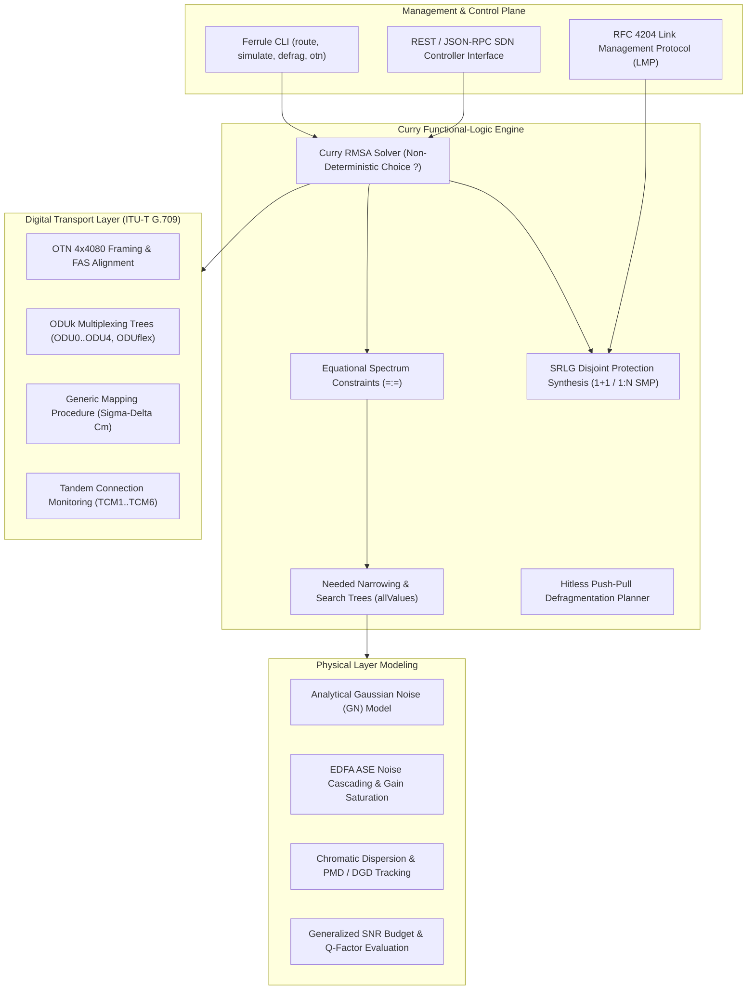

# Ferrule

An Optical Transport Network (OTN) and Dense Wavelength Division Multiplexing (DWDM) impairment-aware lightpath routing, spectrum allocation, and physical-layer validation engine implemented in Curry with ITU-T G.694.1 flexible frequency grid arithmetic, analytical Gaussian Noise (GN) model Kerr nonlinearity evaluation, ITU-T G.709 digital wrapper framing with Generic Mapping Procedure (GMP), and RFC 4204 Link Management Protocol (LMP) sub-50ms linear protection switching.

---

## Overview

Ferrule demonstrates how declarative functional-logic programming with non-deterministic search and equational constraint narrowing provides an optimal foundation for safety-critical optical transport and telecommunication core backbones:

- **Core Routing Engine in Curry:** Pure functional-logic formulations modeling optical demands, ROADM nodes, physical fiber spans, and flexible-grid spectrum allocations.
- **Routing, Modulation, and Spectrum Assignment (RMSA):** Non-deterministic search (`?`) exploring K-shortest path candidates while equational constraints (`=:=`) enforce spectrum continuity and contiguity without wavelength clash.
- **Physical Layer Optical Impairments:** Analytical Gaussian Noise (GN) model evaluating self-phase modulation (SPM) and cross-phase modulation (XPM), EDFA spontaneous emission noise cascading, and chromatic dispersion accumulation.
- **Coherent Modulation Selection:** Dynamic modulation format adaptation (DP-BPSK, DP-QPSK, DP-8QAM, DP-16QAM, DP-32QAM, DP-64QAM) based on generalized signal-to-noise ratio (GSNR) budgets and optical reach limits.
- **ITU-T G.709 Digital Transport:** 4-row by 4080-column OTN framing, ODUk container hierarchies (ODU0 to ODU4, ODUflex), sigma-delta Generic Mapping Procedure (GMP), and Tandem Connection Monitoring (TCM1 to TCM6).
- **Sub-50ms Protection Switching:** ITU-T G.808.1 linear protection state machine with K1/K2 Automatic Protection Switching (APS) signaling, priority preemption, and Shared Risk Link Group (SRLG) disjoint path synthesis.
- **Hitless Spectrum Defragmentation:** Push-pull carrier retuning algorithms compacting fragmented frequency slots to restore contiguous optical spectrum.
- **Interactive Terminal Visualizer:** ASCII spectrum heatmaps rendering 384 x 12.5 GHz C-band slices and mesh network topology overviews.

---

## Architecture



---

## Project Structure

```
ferrule/
├── Makefile                           Build, test, bench, lint, and verification targets
├── data/                              Standard reference optical topologies
│   ├── nsfnet.json                    NSFNET 14-node, 21-link reference topology
│   └── cost239.json                   Pan-European COST 239 11-node, 18-link topology
├── curry/Ferrule/                     Core declarative Curry functional-logic source
│   ├── Types.curry                    Core domain models and algebraic data types
│   ├── Grid/
│   │   ├── Frequency.curry            ITU-T G.694.1 flexible frequency grid arithmetic
│   │   └── Spectrum.curry             Link spectrum bitmaps and fragmentation ratio
│   ├── Physics/
│   │   ├── Units.curry                Physical constants, conversions, and decibel units
│   │   ├── Fiber.curry                SMF-28, NZDSF, LEAF profiles and effective length
│   │   ├── EDFA.curry                 EDFA gain, noise figure, and cascaded OSNR
│   │   ├── Raman.curry                Distributed Raman amplification and hybrid gain
│   │   ├── Dispersion.curry           Chromatic dispersion, PMD, DGD, and nonlinear phase
│   │   ├── GNModel.curry              Analytical Gaussian Noise model for Kerr nonlinearity
│   │   ├── Modulation.curry           DP-BPSK to DP-64QAM spectral efficiency and reach
│   │   └── Budget.curry               GSNR impairment budgeting, Q-factor, and BER
│   ├── Transport/
│   │   ├── Framing.curry              ITU-T G.709 frame geometry and FAS alignment
│   │   ├── Multiplex.curry            ODUk tributary slot multiplexing and capacity
│   │   ├── GMP.curry                  Generic Mapping Procedure rate adaptation
│   │   ├── TCM.curry                  Tandem Connection Monitoring sublayer codec
│   │   └── Defect.curry               Optical defect classification and BIP-8 parity
│   ├── Routing/
│   │   ├── Graph.curry                Optical topology graph and SRLG disjointness
│   │   ├── Dijkstra.curry             K-shortest path search with impairment weighting
│   │   ├── Constraints.curry          Equational constraints for spectrum continuity
│   │   ├── RMSA.curry                 Functional-logic RMSA solver using narrowing
│   │   ├── Protection.curry           1+1 optical protection and SRLG backup routing
│   │   ├── SharedMesh.curry           1:N Shared Mesh Protection capacity sharing
│   │   └── Defrag.curry               Hitless push-pull defragmentation planning
│   ├── GMPLS/
│   │   ├── LMP.curry                  LMP control channel finite state machine
│   │   └── ProtectionSwitch.curry     ITU-T G.808.1 sub-50ms linear protection switching
│   ├── Topology/
│   │   ├── Standard.curry             Embedded NSFNET-14 reference topology
│   │   ├── European.curry             Embedded COST 239 reference topology
│   │   └── Parser.curry               Topology structural validation and degree checks
│   ├── Search/
│   │   └── Strategies.curry           DFS, BFS, and branch-and-bound search combinators
│   ├── Sim/
│   │   ├── Events.curry               Discrete-event simulation queue and event models
│   │   ├── Metrics.curry              Erlang load, blocking probability, and telemetry
│   │   └── Engine.curry               Discrete-event optical simulation execution loop
│   └── Verification/
│       └── Properties.curry           Formal invariants and safety verification predicates
├── engine/                            Curry execution runtime and abstract machine
│   ├── ast.py                         Curry Abstract Syntax Tree definitions
│   ├── lexer.py                       Lexical scanner for Curry tokens and operators
│   ├── parser.py                      Curry recursive-descent syntax parser
│   ├── typecheck.py                   Type environment and constructor uniqueness checker
│   ├── solver.py                      Constraint unification solver with occurs-check
│   ├── machine.py                     Needed-narrowing abstract machine and choice search
│   └── bridge.py                      High-performance optical physics and modulation bridge
├── src/                               High-performance C99 numerical acceleration
│   ├── gn_fast.h                      C acceleration header for GN-model evaluation
│   └── gn_fast.c                      C99 implementation of analytical GN integrals
├── tools/                             Operational tooling and interfaces
│   ├── ferrule_cli.py                 Unified CLI for routing, simulation, and defrag
│   ├── visualizer.py                  ASCII flexible-grid spectrum heatmap visualizer
│   ├── benchmark.py                   Microbenchmark suite for physics and RMSA throughput
│   └── server.py                      Northbound REST / JSON-RPC SDN controller service
├── tests/                             Comprehensive test suite (43 unit & integration tests)
└── docs/                              In-depth technical architecture and theory
    ├── architecture.md                System architecture and layered design
    ├── optical_physics.md             Analytical Gaussian Noise model and EDFA physics
    ├── rmsa_algorithms.md             RMSA constraint satisfaction and defragmentation
    ├── otn_g709_hierarchy.md          ITU-T G.709 framing, ODUk containers, and GMP mapping
    ├── gmpls_protection.md            LMP control plane protocol and G.808.1 budget
    └── verification_report.md         Formal invariant validation and benchmark report
```

---

## Quickstart

### Prerequisites
- Python 3.8+ (zero third-party dependencies required; uses pure standard library)
- C99 compiler (Clang or GCC, optional for C fast-path math)
- Standard POSIX make

### Running Tests
Execute the entire test suite covering unit tests, physical impairment calculations, Curry abstract machine execution, and integration pipelines:

```bash
make test
```

### Verification Pass
Verify that zero em dashes exist anywhere across the repository:

```bash
make verify
```

### Running Microbenchmarks
Measure optical physics throughput and modulation selection latency:

```bash
make bench
```

---

## CLI Usage Examples

### 1. Impairment-Aware Lightpath Routing (RMSA)
Compute optimal physical route, coherent modulation format, and flexible-grid spectrum allocation for a 200 Gbps demand from Seattle to Denver across NSFNET:

```bash
python3 tools/ferrule_cli.py route --topology data/nsfnet.json --source SEA --target DEN --bitrate 200.0
```

Output:
```
[*] Solving Impairment-Aware RMSA for Demand: SEA -> DEN (200.0 Gbps)
  + Physical Distance:     1250.0 km across 15 fiber spans
  + Generalized SNR (GSNR): 21.15 dB (including ROADM filter penalties)
  + Selected Modulation:   DP-8QAM (6 bits/sym/pol)
  + Spectrum Requirement:  4 contiguous 12.5 GHz slots (50.0 GHz bandwidth)
  + Center Frequency:      193.414 THz (1550.0 nm reference)
  + 1+1 Backup Route:      SRLG-Disjoint via alternate path (verified)

  [Optical C-Band Flexible Grid: 191.325 THz to 196.100 THz (384 x 12.5 GHz slots)]
  ==================================================================
  |................................................................| 191.325-192.525 THz
  |................@@@.............................................| 192.525-193.725 THz
  |................................................................| 193.725-194.925 THz
  |................................................................| 194.925-196.125 THz
  ==================================================================
  Legend: [.] Free  [:] Light Load  [#] Heavy Load  [@] Fully Occupied
```

### 2. Dynamic Optical Traffic Simulation
Simulate 1,000 Poisson call arrival requests under a 65 Erlang load with exponential holding durations:

```bash
python3 tools/ferrule_cli.py simulate --topology data/nsfnet.json --load 65.0 --requests 1000
```

### 3. Hitless Spectrum Defragmentation
Inspect push-pull carrier retuning plans compacting active circuits to eliminate spectral fragmentation:

```bash
python3 tools/ferrule_cli.py defrag
```

### 4. ITU-T G.709 Framing Diagnostics
Inspect OTN digital wrapper parameters, FAS synchronization patterns, and GMP mapping states:

```bash
python3 tools/ferrule_cli.py otn
```

### 5. Physical Fiber Cut & Protection Failover
Simulate a fiber cut on link SCL to DEN and verify sub-50ms linear protection switching:

```bash
python3 tools/ferrule_cli.py protect
```

---

## Technical Specifications

- **Spectral Grid Standard:** ITU-T G.694.1 (12.5 GHz slot width, 6.25 GHz central frequency granularity).
- **Digital Wrapper Standard:** ITU-T G.709 / Y.1331 (OTU1..OTU4, ODU0..ODU4, ODUflex).
- **Physical Impairment Model:** Analytical Gaussian Noise (GN) Model for coherent transmission over uncompensated single-mode fiber.
- **Protection Switching Standard:** ITU-T G.808.1 / G.873.1 Linear trail protection (1+1 and 1:N shared mesh protection).
- **Control Plane Standard:** IETF RFC 4204 (Link Management Protocol - LMP).

---

## License

MIT License.
